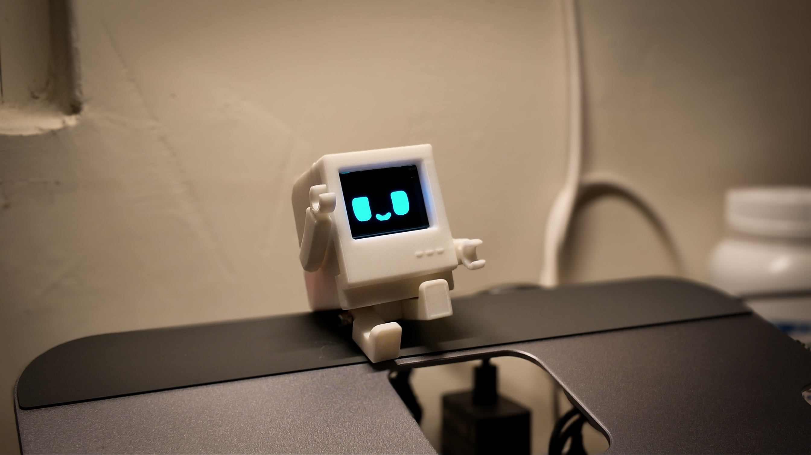

# PommAI (பொம்மை)
> **Your Smart AI Desktop Robot Companion & Personal IoT Avatar**



---

## 📁 Project Structure

```text
PommAI/
├── 3D_Models/            # 3D Printable STL & 3MF files (Configured for Anycubic Kobra 2 Neo)
│   ├── PommAI_Enclosure_Kobra2Neo.3mf
│   └── PommAI_Alternative_Case.3mf
├── firmware/             # ESP32-C3 Firmware source code (PlatformIO)
│   ├── src/              # RTOS tasks (display, network, touch, audio)
│   ├── data/             # On-chip Web Dashboard (LittleFS)
│   └── platformio.ini    # Build & upload configuration (COM8)
├── web/                  # Cloud / Local Web Portal (React + TypeScript + Vite)
│   ├── frontend/         # Interactive Network Graph & Avatar Store
│   └── backend/          # Device WebSocket & REST API
├── tools/                # Browser-based Firmware Flasher (Web Serial)
│   └── flasher/          # PommAI Flasher HTML/JS
└── docs/                 # Guides, Pinouts & Assembly Manual
    └── PommAI_Assembly_Guide.pdf
```

---

## ⚡ Hardware Requirements

| Component | Specification | Connection |
|---|---|---|
| **MCU** | ESP32-C3 Super Mini / Seeed XIAO | USB-C |
| **OLED Display** | 1.3 inch I2C OLED (128x64, SSD1306/SH1106) | SDA -> GPIO 20, SCL -> GPIO 21, 3.3V, GND |
| **Touch Sensor** | TTP223 Capacitive Touch Sensor | OUT -> GPIO 1, 3.3V, GND |
| **Buzzer** | Passive Buzzer | Signal -> GPIO 2, GND |

---

## 🚀 Quick Access

* **On-Device Dashboard:** `http://pommai.local/` (once connected to Wi-Fi)
* **Default Wi-Fi Setup Hotspot:** `PommAI` (Password displayed on OLED QR screen)
* **Local Flasher Tool:** Open `tools/flasher/index.html` in Chrome or Edge

