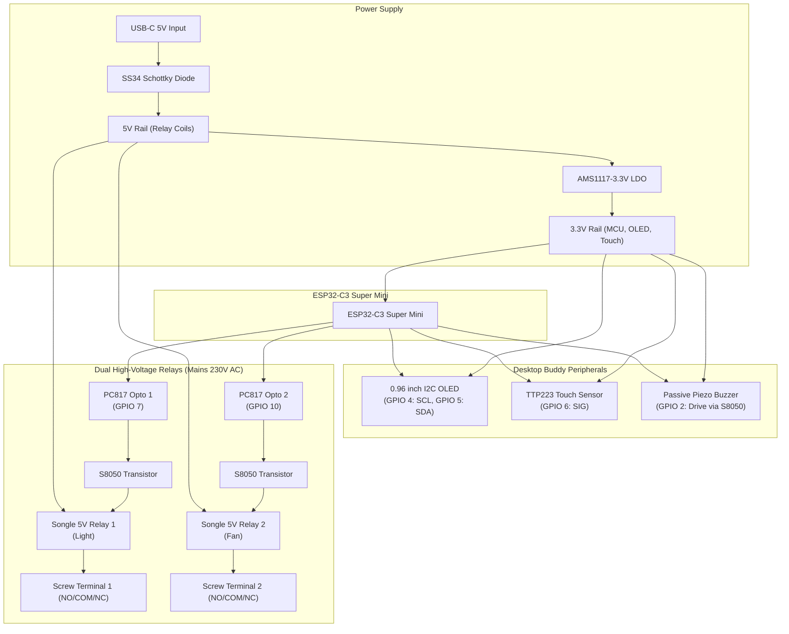

# 🛠️ YUYK All-in-One Smart Hub & Desktop Buddy — PCB Hardware Specification

This document details the complete schematic design, circuit blocks, pin mapping, safety isolation, and PCB manufacturing instructions for the **YUYK All-in-One Smart Hub PCB**.

---

## 1. System Block Diagram



---

## 2. Pin Mapping & Connections

| Module / Component | ESP32-C3 Super Mini Pin | Signal Function | Operating Voltage |
| :--- | :--- | :--- | :--- |
| **OLED Display SCL** | **GPIO 4** | I2C SCL (with 4.7k pullup to 3.3V) | 3.3V |
| **OLED Display SDA** | **GPIO 5** | I2C SDA (with 4.7k pullup to 3.3V) | 3.3V |
| **TTP223 Touch Sensor** | **GPIO 6** | Digital In (SIG) | 3.3V |
| **Buzzer Circuit** | **GPIO 2** | Base drive via 1k resistor to S8050 | 3.3V / 5V |
| **Relay 1 Control (Light)**| **GPIO 7** | Optocoupler Input (active LOW/HIGH) | 3.3V Logic |
| **Relay 2 Control (Fan)** | **GPIO 10** | Optocoupler Input (active LOW/HIGH) | 3.3V Logic |
| **Onboard Blue LED** | **GPIO 8** | Internal to Super Mini board | Built-in |
| **Power Input** | **5V / VBUS** | 5V from USB Type-C | 5.0V |
| **Logic Power** | **3V3** | Output of AMS1117-3.3V | 3.3V |
| **Ground** | **GND** | Common ground plane | 0V |

---

## 3. Circuit Sub-Systems & Schematics

### 3.1. Power Supply Section
* **Input Connector:** USB-C 16-Pin Receptacle (`J3`).
* **CC Pins:** CC1 and CC2 each connected to GND through a **5.1kΩ (0805)** resistor (`R8`, `R9`) to guarantee full 5V 3A negotiation from USB-PD fast chargers.
* **Reverse Polarity Protection:** `D4` (SS34 Schottky Diode, 3A 40V) between `VBUS` and the internal `+5V` rail.
* **Voltage Regulator:** `U4` (AMS1117-3.3V).
  * Input: `+5V` rail with `C4` (10µF 0805) and `C6` (100µF SMD electrolytic).
  * Output: `+3.3V` rail with `C5` (10µF 0805), `C1` (100nF 0805 decoupling), and `C7` (100µF SMD electrolytic).
* **Power LED:** `LED3` (Red) connected between `+3.3V` and GND via `R7` (1kΩ).

### 3.2. Optocoupled Relay Drivers (Channels 1 & 2)
To protect the ESP32-C3 against inductive back-EMF, coil spikes, and 230V AC flashovers, both relays are optically isolated using **PC817**:

```text
[ESP32 GPIO 7] ──[ 1kΩ R1 ]──> Pin 1 (Anode)  PC817 (U2)
                        GND ── Pin 2 (Cathode)

       +5V Rail ──────[ 1kΩ R3 ]──┬── Pin 4 (Collector) PC817 (U2)
                                  │
                                  └──[ Base ]── S8050 NPN (Q1)
                                                  │
                                          Emitter └── GND
                                                  │
                                        Collector └──[ Relay Coil K1 ]── +5V Rail
                                                      │
                                           [ 1N4148 Diode D1 across coil (Cathode to +5V) ]
                                           [ Status LED1 in series with 1k resistor R5 ]
```

* **Relay Output Contacts:**
  * Songle `SRD-05VDC-SL-C` (10A 250V AC).
  * Terminals: `NO` (Normally Open), `COM` (Common), `NC` (Normally Closed).
  * Connected to standard 5.08mm KF301-3P screw connectors.

### 3.3. Buzzer Driver Circuit
* **Buzzer:** 9mm passive/active piezo buzzer (`BZ1`).
* **Driver:** `GPIO 2` connects through `R6` (1kΩ) to the Base of `Q3` (S8050 NPN).
* **Protection:** `D3` (1N4148W) placed in parallel across the buzzer terminals to suppress inductive spikes.

### 3.4. OLED & Touch Sensor Headers
* **OLED Header (`J1`):** 4-pin 2.54mm female header:
  * Pin 1: `GND`
  * Pin 2: `+3.3V`
  * Pin 3: `SCL` (connected to ESP32 `GPIO 4`, with 4.7kΩ pullup `R10` to 3.3V)
  * Pin 4: `SDA` (connected to ESP32 `GPIO 5`, with 4.7kΩ pullup `R11` to 3.3V)
* **Touch Sensor Header (`J2`):** 3-pin 2.54mm male/female header:
  * Pin 1: `+3.3V`
  * Pin 2: `GND`
  * Pin 3: `SIG` (connected to ESP32 `GPIO 6`)

---

## 4. PCB Layout & High-Voltage Safety Guidelines

> [!CAUTION]
> **Mains 230V AC Safety Requirement**:
> The relay contacts will switch high-voltage AC electricity (Lights & Fans). You MUST follow isolation clearances to avoid electrical shock or fire!

1. **Isolation Slots (Air Gap Milling):**
   * A 1.5mm to 2.0mm wide routed physical air slot must be cut under each relay between the low-voltage coil pins and the high-voltage contact pins (`COM`, `NO`, `NC`).
   * Air provides an infinite dielectric breakdown resistance.
2. **High-Voltage Trace Width & Clearance:**
   * Mains AC traces (`COM` and `NO`) carrying up to 10A must be at least **2.5mm to 3.0mm wide** (with tinned exposed solder mask for extra solder bridging).
   * Minimum **3.0mm clearance** between 230V AC copper and any 3.3V / 5V DC ground plane.
3. **Board Dimensions:**
   * Recommended Form Factor: **75mm x 60mm** (or 80mm x 55mm).
   * Perfectly fits inside a compact 3D-printed desktop desk stand or wall-mount enclosure.
4. **Ground Plane:**
   * Continuous copper pour on Bottom Layer for DC Ground.
   * Completely clear out copper pour around the AC relay terminals.

---

## 5. How to Order on JLCPCB / EasyEDA

1. Open **[EasyEDA](https://easyeda.com)** (Free online editor).
2. Create New Project: `YUYK_Smart_Hub`.
3. In the EasyEDA Library search, paste the **LCSC Part Numbers** from [`BOM_LCSC.csv`](file:///c:/Users/yoges/Desktop/New%20folder/pcb_design/BOM_LCSC.csv) (e.g. `C39744` for the relay, `C38114` for PC817).
4. Wire the schematic according to Section 3 above.
5. Click **Convert to PCB** ➡️ Route traces ➡️ Add 4 mounting holes (M3, 3.2mm diameter).
6. Export **Gerber files** and order via **JLCPCB** (standard 1.6mm thickness, FR4, 1oz copper, blue/black solder mask).
